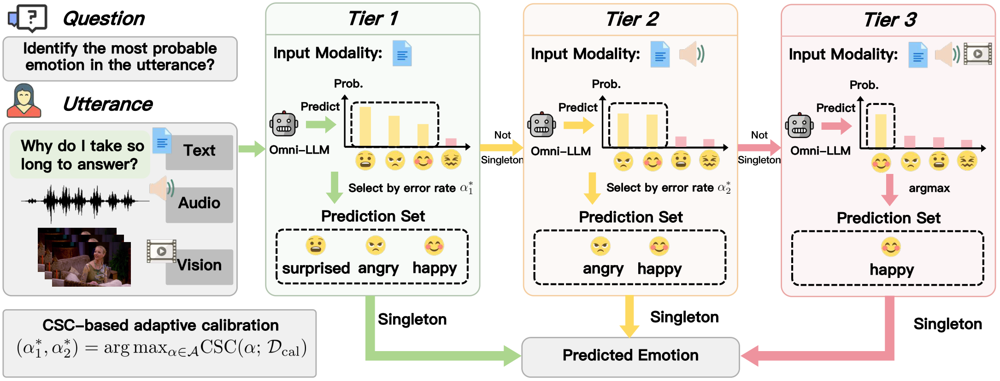

<h1 align="center">
  EmoRouter: Adaptive Modality Cascading for Multimodal Emotion Recognition
</h1>

<p align="center">
  📄 <a href="#"><strong>Paper</strong></a> (coming soon)
</p>

<p align="center">
  <a href="https://yu-fangxu.github.io/">Fangxu Yu</a><sup>1</sup>,
  <a href="https://lingzhiyxp.github.io/">Lingzhi Yuan</a><sup>1</sup>,
  <a href="https://zhishanq.github.io/">Dehai Min</a><sup>2</sup>,
  <a href="https://ft2023.github.io/taofeng.github.io/">Tao Feng</a><sup>3</sup>,
  <br>
  <a href="https://siebelschool.illinois.edu/about/people/all-faculty/geliu">Ge Liu</a><sup>3</sup>,
  <a href="https://furong-huang.com/">Furong Huang</a><sup>1</sup>,
  <a href="https://tianyizhou.github.io/">Tianyi Zhou</a><sup>4*</sup>
</p>

<p align="center">
  <sup>1</sup>University of Maryland, College Park &nbsp;
  <sup>2</sup>University of Illinois Chicago &nbsp;
  <sup>3</sup>University of Illinois Urbana-Champaign &nbsp;
  <sup>4</sup>Mohamed bin Zayed University of Artificial Intelligence
  <br>
  <sup>*</sup>Corresponding author
</p>



## 🔥 Overview

**EmoRouter** is a **training-free, model-agnostic** routing framework that selects the modality combination for each utterance in multimodal emotion recognition (MER) with an Omni-LLM.

Different utterances favor different modalities: when the transcript is ambiguous, acoustic and visual cues are indispensable, whereas when the text alone is expressive, the extra modalities are redundant, may interfere, and cost most of the inference time. EmoRouter sends each utterance through a cascade of increasingly expensive modality tiers, **T → T+A → T+A+V**, and exits at the first tier whose **conformal prediction (CP) set** contains a single emotion. The per-tier error budgets $(\alpha_1, \alpha_2)$ are chosen by **Conformal Set Contraction (CSC)**, a structural criterion computed on calibration data only:

```math
(\alpha_1^{\ast}, \alpha_2^{\ast}) = \arg\max_{\alpha \in \mathcal{A}} \text{CSC}(\alpha;\ \mathcal{D}_{\text{cal}})
```

Across 4 MER benchmarks and 3 Omni-LLMs, EmoRouter matches or outperforms full-modality inference while reducing inference latency by 68.8–94.6%.

## 🚀 Key Features

- 🧊 **Training-free**: routing only reads the Omni-LLM's output probabilities at each tier. No router is trained and the backbone is untouched.
- 📐 **Uncertainty with guarantees**: exits are decided by split-CP prediction sets, whose coverage is controlled by the per-tier error budget $\alpha_\ell$.
- 🎯 **Label-free operating point**: CSC selects $(\alpha_1, \alpha_2)$ from how fast prediction sets contract across tiers on calibration data, with no threshold tuning on accuracy or latency.
- 🔁 **Model-agnostic**: the same pipeline works with Qwen2.5-Omni-7B, Qwen3-Omni-30B-A3B, and MiniCPM-o-2.6, and the selected error budgets transfer across backbones.

## 🖥️ Installation

```bash
conda create -n emorouter python=3.11 -y
conda activate emorouter
pip install -r requirements.txt
pip install vllm==0.8.5        # for serving the Omni-LLM (a separate env also works)
```

`ffmpeg` must be on `PATH` (audio is extracted from the video clips).

## 📥 Download the Data

EmoRouter is evaluated on [IEMOCAP](https://sail.usc.edu/iemocap/), [MELD](https://affective-meld.github.io/), [CMU-MOSEI](http://multicomp.cs.cmu.edu/resources/cmu-mosei-dataset/), and [CMU-MOSI](http://multicomp.cs.cmu.edu/resources/cmu-mosi-dataset/), with [CH-SIMS](https://github.com/thuiar/MMSA) used for the cross-modal-conflict analysis. Obtain each dataset from its official source and place it under `data/` (every path can also be set with a command-line flag):

```
data/
├── IEMOCAP_full_release/       # Session1-5            (--iemocap_full)
├── iemocap_splits/             # generated, see below  (--iemocap_labels)
├── MELD/MELD.Raw/              # *_sent_emo.csv, dev_splits_complete/, output_repeated_splits_test/   (--meld_base)
├── CMU-MOSEI/                  # CMU-MOSEI/labels/, CMU-MOSEI/languages/, Raw/<video_id>/<seg>.mp4   (--mosei_base)
├── CMU-MOSI/                   # label.csv, Raw/<video_id>/<clip_id>.mp4                             (--mosi_base)
└── CH-SIMS/                    # label.csv, Raw/<video_id>/<clip_id>.mp4                             (--chsims_base)
```

Build the 6-class IEMOCAP split (Session 1–4 for calibration, Session 5 for test):

```bash
python scripts/prepare_iemocap.py --iemocap_root data/IEMOCAP_full_release --out_dir data/iemocap_splits
```

| Dataset | Classes | Calibration split | Test split |
|:-|:-|:-:|:-:|
| IEMOCAP | angry, excited, frustrated, happy, neutral, sad | Session 1–4 (5,758) | Session 5 (1,622) |
| MELD | anger, disgust, fear, joy, neutral, sadness, surprise | dev (1,109) | test (2,610) |
| CMU-MOSEI | negative, neutral, positive | valid (1,871) | test (4,662) |
| CMU-MOSI | negative, neutral, positive | valid (229) | test (686) |
| CH-SIMS | negative, neutral, positive | valid (456) | test (457) |

## 🎯 Run Per-Tier Inference

Serve the Omni-LLM with [vLLM](https://github.com/vllm-project/vllm), then query each tier (T, T+A, T+A+V) on the calibration and test splits. Each script records the class probabilities from the answer-letter logprobs and the wall-clock latency of every request:

```bash
vllm serve /path/to/Qwen2.5-Omni-7B --served-model-name qwen2.5-omni \
  --trust-remote-code --max-model-len 4096 --port 8000
python inference/run_meld.py --model qwen2.5-omni --output_dir outputs/meld_qwen25
```

The same interface applies to `run_iemocap.py`, `run_mosei.py`, `run_mosi.py`, and `run_chsims.py`. Runs are resumable. The output directory contains one file per split and tier:

```
outputs/meld_qwen25/
├── dev_T_probs.jsonl   dev_T_A_probs.jsonl   dev_T_A_V_probs.jsonl
└── test_T_probs.jsonl  test_T_A_probs.jsonl  test_T_A_V_probs.jsonl
# each line: {"id", "ground_truth", "probs": {label: p}, "prompt_tokens", "inference_time", ...}
```

`scripts/run_all.sh` automates serving, inference on all datasets, and routing for one model:

```bash
MODEL_PATH=/path/to/Qwen2.5-Omni-7B SERVED_NAME=qwen2.5-omni TAG=qwen25 bash scripts/run_all.sh
```

## 🧭 Route with EmoRouter

Routing runs offline on the saved probabilities, so no GPU is needed. CSC searches $\alpha_1, \alpha_2 \in \lbrace 0.1, 0.3, 0.5, 0.7, 0.9 \rbrace$ on the calibration split, and the test utterances are then routed:

```bash
python router/emorouter.py --pred_dir outputs/meld_qwen25 --dataset meld
```

Use `--alpha1/--alpha2` to fix the budgets instead of selecting them with CSC. We report weighted F1 (wF1), the latency reduction rate relative to always running T+A+V (LRR), and the time utility $U_t = (\text{wF1} - \text{wF1}_{\text{T}}) / (1 - \text{LRR})$.

## 📖 Citation

If you find this work useful, please cite:

```bibtex
@article{yu2026emorouter,
  title={EmoRouter: Adaptive Modality Selection for Multimodal Emotion Recognition},
  author={Yu, Fangxu and Yuan, Lingzhi and Min, Dehai and Feng, Tao and Liu, Ge and Huang, Furong and Zhou, Tianyi},
  year={2026}
}
```

## 🙏 Acknowledgements

Backbones: [Qwen2.5-Omni](https://huggingface.co/Qwen/Qwen2.5-Omni-7B), [Qwen3-Omni](https://huggingface.co/Qwen/Qwen3-Omni-30B-A3B-Instruct), and [MiniCPM-o 2.6](https://huggingface.co/openbmb/MiniCPM-o-2_6). Serving: [vLLM](https://github.com/vllm-project/vllm). The CMU-MOSEI standard folds (`inference/mosei_std_folds.json`) are taken from the [CMU-MultimodalSDK](https://github.com/CMU-MultiComp-Lab/CMU-MultimodalSDK).
